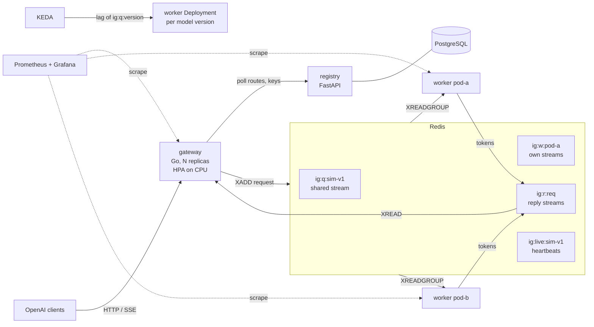
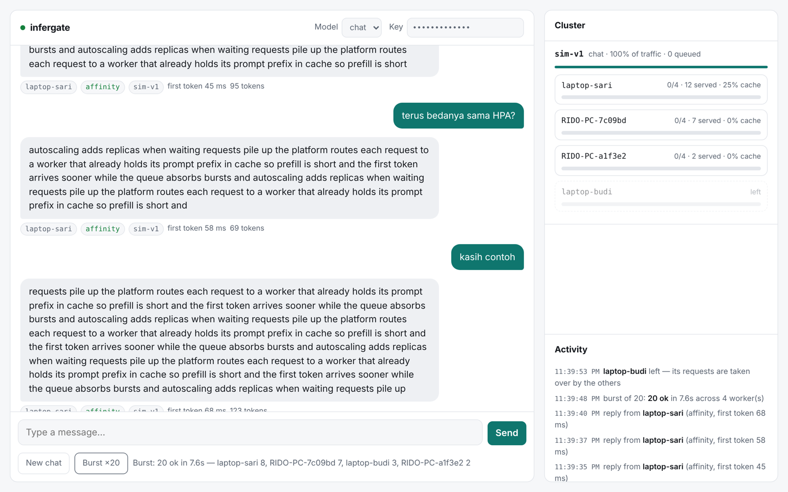

# infergate

[](https://github.com/Epinnn14/infergate/actions/workflows/ci.yaml)

An OpenAI-compatible LLM inference platform for Kubernetes. A Go gateway routes chat completions
over Redis Streams to Python model workers. Requests from the same conversation go to the worker
that already holds its prompt prefix in cache. KEDA scales each model version on queue lag, and a
PostgreSQL registry runs canary rollouts without a redeploy.

```
curl localhost:8080/v1/chat/completions -H "Authorization: Bearer sk-demo-local" \
  -d '{"model": "chat", "messages": [{"role": "user", "content": "hello"}], "stream": true}'
```

Any OpenAI client works by pointing `base_url` at the gateway.

**Use it for your own models.** Click **Use this template**, or read
[docs/USING.md](docs/USING.md): quick start, connecting Ollama, vLLM or a hosted API, calling it
from your app, canary rollouts, deployment and configuration.

## Measured

These numbers come from the same machine, the same load and the same four simulated GPU workers
(capacity 8, prefix cache of 24 conversations each). The load is 64 multi-turn conversations with
6,000-character system prompts and 24 concurrent clients over 60 s (`scripts/bench-local.sh`).

| Routing | OK | Throughput | TTFT p50 / p90 / p99 | Latency p50 | Prefix cache hits |
|---|---|---|---|---|---|
| **Prefix affinity** (infergate) | 586 / 586 | 9.4 req/s, 584 tok/s | **163** / 938 / 1161 ms | 2412 ms | **76%** |
| Single shared queue | 541 / 541 | 8.7 req/s, 541 tok/s | 922 / 941 / 960 ms | 2922 ms | 33% |

With affinity routing, median time to first token is **5.7× lower**, throughput is 8% higher and
median latency is 17% lower. The p99 is higher because, once a worker is full, a conversation's
request spills to its second-choice worker. The routing breakdown was 484 affinity, 96 spill and
6 shared.

**Chaos** (`scripts/chaos-local.sh`): three workers, one is `kill -9`'d 10 s into the load.
**257 / 257 requests succeed.** The surviving workers take over the 10 requests that were queued
on or running at the dead worker. Those requests wait for dead-worker detection (5 s), which
shows up in p99 latency (34 s) rather than as errors.

CI reruns both scripts on every push and posts the tables in the run summary. It also runs a
Kubernetes end-to-end test on kind (see below).

## Architecture



What happens to one request:

1. **Auth and limits.** The gateway hashes the bearer key and looks it up in the registry
   snapshot. It then checks requests per minute and tokens per minute with a token bucket in
   Redis (a single Lua script, so it holds across all gateway replicas). Prompt and `max_tokens`
   are charged up front; unused tokens are refunded at the end.
2. **Version.** The gateway picks the model version by registry weight, for example 90% `v1` and
   10% `v2`. The choice is sticky per API key and conversation, so a conversation never flips
   between versions halfway through.
3. **Worker.** The routing key is the part of the prompt that later requests start with too: the
   leading system prompt if there is one, otherwise the conversation's first message, so a
   conversation keeps the same key as it grows. The key is ranked against the live workers by
   rendezvous hashing. The top worker gets the request on its own stream unless its load
   ((in-flight + queued) / capacity) is at the limit; then the second choice gets it. If both
   are full, the request goes to the version's shared stream, which every worker reads and KEDA
   watches.
4. **Generation.** The worker runs continuous batching and appends `token` events to the
   request's reply stream, then a `done` event with usage. The gateway turns these into OpenAI
   SSE chunks or a single JSON response.
5. **Failure.** If the client disconnects, the gateway sets a cancel key and the worker stops
   generating. If a worker dies, a peer notices the heartbeat stop, takes over the dead worker's
   queued and half-finished requests, and runs them again as a new attempt. The gateway discards
   the partial output, or ends the stream with an error if tokens were already sent, so no client
   ever receives duplicated text.

More detail is in [docs/architecture.md](docs/architecture.md): the Redis key layout, the
delivery guarantees and every failure mode with how it is handled.

### Design decisions

- **Redis Streams as the queue.** They provide consumer groups, a per-message ack, `XAUTOCLAIM`
  for stalled messages and a cheap stream per worker, which is what affinity routing needs. The
  same Redis also holds rate-limit buckets, heartbeats and reply streams, so one dependency does
  the work of a broker, a cache and a pub/sub. At larger scale, streams shard by model version
  onto a Redis Cluster.
- **Affinity with spillover instead of pure least-load.** Recomputing a 6,000-character prefix
  costs far more than decoding a few tokens. Rendezvous hashing keeps a conversation on the same
  worker, and only about 1/N of conversations move when a worker joins or leaves. Spilling on
  load keeps one hot conversation from pinning a full worker.
- **KEDA scales on overflow, not on total load.** Requests reach the shared stream only after
  every candidate worker is full, so its lag is exactly the demand the current replicas can't
  absorb. The same signal scales a canary version from zero the moment weight is shifted to it.
- **At-least-once delivery that clients see as exactly-once.** Every redelivery carries an attempt
  number. The worker emits `restart` and the gateway resets its buffer. Workers that are shutting
  down move to a `draining` set: gateways stop routing to them, but if the drain is cut short by
  SIGKILL, peers still rescue their work.
- **Canary weights live in the registry, not in Git.** Shifting traffic is an API call that every
  gateway picks up within one poll. Argo CD owns the manifests and leaves the weights alone, and
  KEDA or the HPA owns replica counts.
- **Gateway in Go with the standard library only**, including a RESP client and the Prometheus
  exposition format. The gateway is a 6.5 MB static binary with no dependency tree.
- **A simulated GPU backend** (`IG_BACKEND=fake`) models what makes inference scheduling hard:
  per-step latency grows with batch size, prefill cost is per prompt token, and an LRU prefix
  cache cuts prefill by 85% on a hit. With it, routing can be benchmarked on a laptop or a CI
  runner. `IG_BACKEND=openai` puts any OpenAI-compatible engine behind the same protocol:
  Ollama, vLLM (as a sidecar), SGLang or a hosted API. `IG_BACKEND=hf` runs a Hugging Face
  model in-process.

## Run it

**Docker Compose** brings up everything, including Prometheus and Grafana, on one machine:

```bash
docker compose up --build --scale worker=3
# API on :8080, admin API on :8090, Grafana on :3000 (dashboard "infergate"), Prometheus on :9090
```

**LAN mode**: one laptop is the hub, and every other computer on the same Wi-Fi joins as a
worker with a single `docker run`. The gateway also serves a chat page at `/` that shows which
machine answered each reply and a live view of the cluster. See [deploy/lan](deploy/lan/README.md).

```powershell
.\deploy\lan\hub.ps1      # prints the chat link and the join command for other laptops
```



**Kubernetes on kind**, the same way CI does it:

```bash
make e2e          # builds images, creates a 3-node kind cluster, installs KEDA and the chart, runs the checks
```

**Terraform** installs a kind cluster plus kube-prometheus-stack, KEDA, the chart and,
optionally, Istio and Argo CD:

```bash
cd deploy/terraform/envs/kind && terraform init && terraform apply
# or an existing cluster:
cd deploy/terraform/envs/existing-cluster && terraform apply -var kube_context=my-cluster
```

**Argo CD**: `kubectl apply -n argocd -f deploy/argocd/application.yaml`

**A real model** on CPU (Qwen2.5-0.5B-Instruct, about 1 GB):

```bash
docker build -t infergate-worker:hf --build-arg EXTRAS=hf worker
# Helm: set models[].versions[].backend=hf and env.IG_HF_MODEL; add nvidia.com/gpu to resources for GPU nodes
```

### Canary rollout

```bash
ADMIN=$(kubectl -n infergate get secret infergate -o jsonpath='{.data.admin-token}' | base64 -d)
curl -X PUT localhost:8090/v1/models/chat/weights -H "Authorization: Bearer $ADMIN" -d '{"sim-v1": 90, "sim-v2": 10}'
# watch "Traffic split by version" in Grafana; KEDA has already started sim-v2 workers
curl -X PUT localhost:8090/v1/models/chat/weights -H "Authorization: Bearer $ADMIN" -d '{"sim-v1": 0, "sim-v2": 100}'
```

To create an API key: `POST /v1/keys {"name": "team-a", "rpm": 120, "tpm": 200000, "models": ["chat"]}`.
The secret is returned once and only its SHA-256 hash is stored.

## What CI checks

| Job | What it proves |
|---|---|
| Go | `go vet`, `gofmt`, unit and integration tests with `-race` against real Redis: routing, rate limits, streaming, cancellation, overload shedding, restart after a worker died |
| Python | Worker (14 tests: affinity streams, prefix cache, cancel and deadline, capacity, dead-worker rescue, kill during drain, stalled reclaim, graceful hand-back, the OpenAI-compatible engine backend) and registry (canary weights, keys, idempotent bootstrap) against real Redis and PostgreSQL |
| Helm, Terraform | `helm lint --strict` and kubeconform on every values set, including the KEDA, Prometheus Operator and Istio CRDs; `terraform validate` for both environments |
| Benchmark | Affinity versus shared queue, plus the chaos run, with tables in the job summary |
| End-to-end on kind | Installs KEDA and the chart, then: API smoke test; KEDA scales workers out under 48 concurrent clients; a 20% canary on a version with 0 replicas scales from zero and serves traffic; a worker pod is force-deleted mid-load with no request lost |
| Images | On `main`: multi-arch images pushed to GHCR as `<repo>-gateway`, `-worker`, `-registry` (here `infergate-*`) |

## Observability

The gateway and the workers export Prometheus metrics: requests by status, routing decisions
(affinity, spill, shared), TTFT and duration histograms per version, queue depth, live workers,
tokens, prefix cache hits, reclaimed requests and rate-limit refusals. The chart ships a Grafana
dashboard (`deploy/helm/infergate/files/dashboard.json`), ServiceMonitor and PodMonitor
resources, and a PrometheusRule. The rule records SLIs and alerts on 5xx ratio, p99 TTFT, queue
backlog, versions with waiting requests and no workers, and rescue storms.

## Layout

```
cmd/gateway, cmd/loadgen      gateway and load generator (Go)
internal/                     redis client, queue protocol, router, rate limiter, metrics, registry client, HTTP API
worker/                       model worker (Python, asyncio): fake and Hugging Face backends
registry/                     model / version / key registry (FastAPI + PostgreSQL)
deploy/helm/infergate         Helm chart: gateway, registry, per-version workers, KEDA, monitoring, Istio, NetworkPolicy
deploy/terraform              module "platform" plus envs/kind and envs/existing-cluster
deploy/argocd                 Argo CD Application
deploy/lan                    LAN mode: hub on one laptop, workers on the others
scripts/                      bench, chaos, kind end-to-end
```

## Limits and next steps

- Redis is a single point of failure in the default chart. In production, use managed Redis with
  replication via `redis.external`. Request streams are per model version, so they spread across
  a Redis Cluster without cross-slot operations.
- Prefix identity is a hash over whole messages. Real engines cache in token blocks, so routing
  on block hashes reported by vLLM or SGLang workers would catch partial overlaps too.
- To make it multi-region, run one Redis and one set of workers per region (a cell), keep the
  registry global and route clients to their nearest cell with GeoDNS. Each cell keeps local
  queues, so a regional outage only drains that cell.
